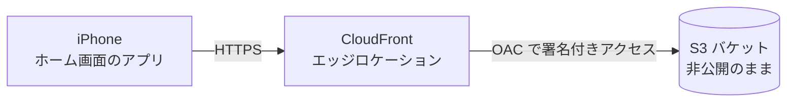

# AWS にデプロイする手順 (S3 + CloudFront)

CLF-C02 クエストを自分の AWS アカウントで公開して、iPhone のホーム画面からアプリとして使えるようにする手順です。
所要時間の目安は 30〜60 分。どのステップも試験範囲のサービスなので、手を動かしながら復習できます。



S3 バケットは**非公開のまま**にして、CloudFront だけが読めるようにします(OAC: オリジンアクセスコントロール)。
HTTPS は CloudFront のドメイン(`xxxx.cloudfront.net`)でそのまま使えるので、証明書の準備はいりません。

> AWS のコンソール画面は頻繁に変わります。ボタン名や並び順が違っていたら、近い名前の項目を探してください。

---

## 0. 最初にやるセキュリティ設定(10分)

アプリより先に、アカウントを守る設定をしておきます。

1. **ルートユーザーに MFA を設定する**
   右上のアカウント名 → 「セキュリティ認証情報」→「MFA デバイスを割り当てる」。スマホの認証アプリかパスキーを登録します。
2. **普段の作業用ユーザーを作る**
   IAM → ユーザー → 「ユーザーを作成」。コンソールアクセスを有効にし、権限は `AdministratorAccess` を付けます。作成後、このユーザーにも MFA を設定し、以降はこのユーザーでサインインします。
   (組織で使うなら IAM Identity Center が推奨ですが、個人の学習用ならまずは IAM ユーザーで十分です)
3. **予算アラートを作る**
   「請求とコスト管理」→「予算」→「予算を作成」→ テンプレートの「ゼロ支出予算」を選び、通知先にメールアドレスを入れます。1セントでも課金が発生したらメールが届きます。
   (無料プランの「AWS Budgets を設定する」アクティビティにもなるので、クレジットがもらえるはずです)
4. **リージョンを「アジアパシフィック (東京) ap-northeast-1」にする**
   右上のリージョン選択から変更します。CloudFront はグローバルなサービスなので、リージョンは S3 用です。

**ここで出てきた試験ワード**: ルートユーザー、MFA、IAM ユーザー、最小権限の原則、AWS Budgets、リージョン

---

## 1. S3 バケットを作る

S3 → 「バケットを作成」で、次のように設定します。

| 項目 | 設定 |
| --- | --- |
| バケットタイプ | 汎用 |
| バケット名 | 世界で一意な名前。例: `clf-quest-<好きな英数字>` |
| オブジェクト所有者 | ACL 無効 (推奨) |
| ブロックパブリックアクセス | **すべてブロック(オンのまま)** |
| バージョニング | どちらでもよい(有効にすると誤って上書きしても戻せる) |
| 暗号化 | デフォルトの SSE-S3 のまま |

**ここで出てきた試験ワード**: S3 バケット(名前はグローバルで一意)、ブロックパブリックアクセス、バージョニング、保存時の暗号化(SSE-S3)

---

## 2. ファイルをアップロードする

1. GitHub のこのリポジトリで「Code」→「Download ZIP」を押してダウンロードし、解凍します。
2. 解凍したフォルダの中の `aws-cp-quest` フォルダを開きます。
3. S3 で作ったバケットを開き、「アップロード」→ 次のファイルとフォルダを**バケットの直下に**ドラッグ&ドロップします。

```
index.html
app.js
sw.js
manifest.json
data/     ← フォルダごと
icons/    ← フォルダごと
```

`README.md`、`DEPLOY.md`、`deploy.sh` はアップロード不要です。
`aws-cp-quest/` フォルダごと上げると URL がずれるので、**中身だけ**を上げてください。

---

## 3. CloudFront ディストリビューションを作る

CloudFront → 「ディストリビューションを作成」。

1. **料金プラン**: プランを選ぶ画面が出たら **Free プラン(月 $0)** を選びます。
   出てこない場合は従量課金でも、このアプリの規模ならごくわずかです(アカウントが無料プランの間はクレジットから引かれ、請求はされません)。
2. **オリジン**: オリジンの種類で **Amazon S3** を選び、手順1のバケットを選びます。
   `xxxx.s3.ap-northeast-1.amazonaws.com` の形のものです。S3 の「静的ウェブサイトホスティング」のエンドポイントは使いません。
3. **オリジンアクセス**: 「オリジンアクセスコントロール (OAC)」を選び、新しく作成します。
   バケットポリシーを自動で更新する選択肢があればそれを選びます。なければ下の「バケットポリシーを手で設定する」を参照してください。
4. **ビューワープロトコルポリシー**: 「Redirect HTTP to HTTPS」
5. **デフォルトルートオブジェクト**: `index.html`
6. **WAF(セキュリティ保護)**: Free プランなら含まれています。従量課金の場合は有料なので、今回はオフで大丈夫です。
7. 作成すると、数分でデプロイが完了します。表示される **ディストリビューションドメイン名**(`dxxxxxxxxxxxx.cloudfront.net`)をメモします。

### バケットポリシーを手で設定する場合

S3 → バケット → 「アクセス許可」→「バケットポリシー」に次を貼り付けます。`<...>` の3か所を自分の値に置き換えてください。

```json
{
  "Version": "2012-10-17",
  "Statement": [
    {
      "Sid": "AllowCloudFrontServicePrincipalReadOnly",
      "Effect": "Allow",
      "Principal": { "Service": "cloudfront.amazonaws.com" },
      "Action": "s3:GetObject",
      "Resource": "arn:aws:s3:::<バケット名>/*",
      "Condition": {
        "StringEquals": {
          "AWS:SourceArn": "arn:aws:cloudfront::<アカウントID(12桁)>:distribution/<ディストリビューションID>"
        }
      }
    }
  ]
}
```

「CloudFront というサービスが、自分のこのディストリビューション経由で来たときだけ、このバケットのオブジェクトを読める」という意味です。

**ここで出てきた試験ワード**: CloudFront、エッジロケーション、OAC、バケットポリシー(リソースベースのポリシー)、転送中の暗号化(HTTPS)

---

## 4. iPhone に入れる

1. iPhone の **Safari** で `https://dxxxxxxxxxxxx.cloudfront.net` を開きます。
2. 共有ボタン →「ホーム画面に追加」。アイコンがホーム画面に並びます。
3. **ホーム画面のアイコンから**一度起動します。この時点でアプリの全ファイルが iPhone に保存され、以降はオフラインでも動きます。

- 学習記録は「Safari で開いたとき」と「ホーム画面のアプリ」で別々に保存されます。普段はアプリ側を使ってください。
- 今までの Artifact 版の記録は引き継がれません。

---

## 5. アプリを更新するとき

### コンソールでやる場合

1. 変更したファイルを S3 に同じ名前でアップロードし直します(上書き)。
2. CloudFront → ディストリビューション →「キャッシュ削除(無効化)」→ オブジェクトパスに `/*` を入れて作成します。
3. iPhone でアプリを**2回開き直す**と新しい版になります(1回目の起動で裏で更新を取得し、2回目で切り替わります)。

### AWS CLI でやる場合(おすすめ)

AWS CLI v2 をインストールして認証情報を設定したら、次の1行で済みます。

```bash
BUCKET=<バケット名> DISTRIBUTION_ID=<ディストリビューションID> ./deploy.sh
```

認証情報は、IAM ユーザーのアクセスキーを作って `aws configure` で設定するのが一番手軽です。ただしアクセスキーは漏れると危険なので、GitHub などに絶対に載せないでください。ブラウザでサインインして一時的な認証情報を使う方法もあるので、余裕があれば AWS CLI の公式ドキュメントで確認してみてください。

### ファイルを増やしたり名前を変えたりしたとき

`sw.js` の `PRECACHE` にファイルを追加し、`VERSION` を `v4`、`v5` … と上げてからデプロイしてください。

---

## うまくいかないとき

| 症状 | よくある原因 |
| --- | --- |
| `AccessDenied` という XML が表示される | バケットポリシーが未設定 / ファイルがバケット直下にない / デフォルトルートオブジェクトが未設定 |
| 更新したのに古いまま | CloudFront の無効化をしていない / アプリを2回開き直していない |
| アイコンが変わらない | ホーム画面のアイコンを削除して、もう一度「ホーム画面に追加」する |
| オフラインで開けない | 電波のある場所で、ホーム画面のアイコンから一度起動していない |

---

## 片付けるとき

1. CloudFront: ディストリビューションを「無効化(Disable)」→ 完了後に「削除」
2. S3: バケットを「空にする」→「削除」

---

## このデプロイで触った試験ワードまとめ

| 試験ワード | どこで触ったか | ドメイン |
| --- | --- | --- |
| ルートユーザー / MFA / IAM ユーザー | 0. セキュリティ設定 | D2 |
| AWS Budgets | 0. 予算アラート | D4 |
| リージョン | 0. 東京リージョンを選択 | D3 |
| S3 / ブロックパブリックアクセス / SSE-S3 | 1. バケット作成 | D2・D3 |
| CloudFront / エッジロケーション | 3. ディストリビューション作成 | D3 |
| OAC / バケットポリシー(リソースベースのポリシー) | 3. オリジンアクセス | D2 |
| 転送中の暗号化 (HTTPS) | 3. Redirect HTTP to HTTPS | D2 |
| 責任共有モデル | バケットを非公開にする設定は顧客の責任 | D2 |
